<div align="center">

[](README.md)
[](README.ru.md)

<picture><source media="(prefers-color-scheme: dark)" srcset=".github/assets/header-dark.svg"></picture>

**Voice typing for Linux.**<br>
Press a key, speak, release it, and the text appears where the cursor is. Local whisper.cpp, Vulkan, Wayland.

[](https://github.com/Trendorin/sotto/releases/latest) [](LICENSE)  <br>
[](#install) [](#usage)

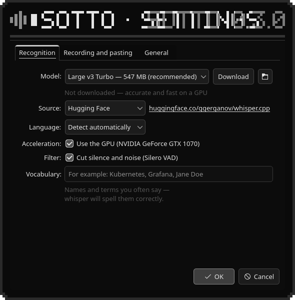

[](https://github.com/Trendorin/sotto/releases/latest)
[](#install)
[](#docs)

</div>

<a id="about"></a>

<div align="center">

<picture><source media="(prefers-color-scheme: dark)" srcset=".github/assets/label-about-dark.svg">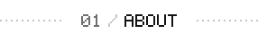</picture>

</div>

Sotto (as in *sotto voce*) is a small native app that turns speech into text right where you
type. It lives in the tray, listens only while you hold or toggle its key, recognises speech
locally with whisper.cpp and pastes the result into the active window.

- **Native and light**: C++, Qt 6 and whisper.cpp, no Python or Electron. A few megabytes when
  idle; the model is unloaded after a while without use.
- **Looks like your system**: plain Qt widgets that follow your theme, accent and fonts.
- **Made for Wayland**: the indicator floats above windows through `wlr-layer-shell` without
  taking focus; the hotkey comes from the GlobalShortcuts portal and pasting goes through the
  RemoteDesktop portal. No root, no `ydotool`.
- **English and Russian** interface, picked from the system language.

<div align="center">

<picture><source media="(prefers-color-scheme: dark)" srcset=".github/assets/mark-dark.svg"></picture> <picture><source media="(prefers-color-scheme: dark)" srcset=".github/assets/spec-dark.svg"></picture>

</div>

<a id="features"></a>

<div align="center">

<picture><source media="(prefers-color-scheme: dark)" srcset=".github/assets/label-features-dark.svg"></picture>

</div>

<div align="center">

<picture><source media="(prefers-color-scheme: dark)" srcset=".github/assets/feature-hotkey-dark.svg"></picture> <picture><source media="(prefers-color-scheme: dark)" srcset=".github/assets/feature-local-dark.svg"></picture>
<picture><source media="(prefers-color-scheme: dark)" srcset=".github/assets/feature-fast-dark.svg"></picture> <picture><source media="(prefers-color-scheme: dark)" srcset=".github/assets/feature-clean-dark.svg"></picture>
<picture><source media="(prefers-color-scheme: dark)" srcset=".github/assets/feature-wayland-dark.svg"></picture> <picture><source media="(prefers-color-scheme: dark)" srcset=".github/assets/feature-verified-dark.svg"></picture>

</div>

<a id="install"></a>

<div align="center">

<picture><source media="(prefers-color-scheme: dark)" srcset=".github/assets/label-install-dark.svg"></picture>

</div>

| your system | file from the [latest release](https://github.com/Trendorin/sotto/releases/latest) |
|---|---|
| **Arch Linux**, CachyOS, Manjaro | `sotto-0.3.0-1-x86_64.pkg.tar.zst` |
| **Debian 13** and newer | `sotto_0.3.0-1_amd64.deb` |
| **Fedora 44** and newer | `sotto-0.3.0-1.fc44.x86_64.rpm` |
| **any distribution** with glibc 2.35+ | `Sotto-0.3.0-x86_64.AppImage`, nothing to install |

```sh
sudo pacman -U ./sotto-0.3.0-1-x86_64.pkg.tar.zst       # Arch
sudo apt install ./sotto_0.3.0-1_amd64.deb               # Debian
sudo dnf install ./sotto-0.3.0-1.fc44.x86_64.rpm       # Fedora
chmod +x Sotto-0.3.0-x86_64.AppImage && ./Sotto-0.3.0-x86_64.AppImage
```

Each package is built in a clean container of its distribution, installed and started there
before it is published. Check downloads with `sha256sum --ignore-missing -c SHA256SUMS`.

The AppImage carries Qt, whisper.cpp, Vulkan acceleration and CPU builds for any processor;
it needs the system's Vulkan loader for the GPU. On first start it adds itself to the menu
(the portals need that to grant a hotkey).

<details>
<summary><b>Build from source</b></summary>

On Arch, `./install.sh` builds a real pacman package. Elsewhere it installs into `~/.local`
and needs cmake, a C++ compiler, Qt 6 (Widgets, Multimedia, DBus, Network, Wayland),
layer-shell-qt, whisper.cpp and wl-clipboard.

```sh
git clone https://github.com/Trendorin/sotto && cd sotto
./install.sh
packaging/appimage/build.sh     # your own AppImage, rootless (no docker or podman)
```

</details>

<a id="usage"></a>

<div align="center">

<picture><source media="(prefers-color-scheme: dark)" srcset=".github/assets/label-usage-dark.svg">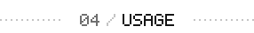</picture>

</div>

1. Start **Sotto** from the menu. The first time, the settings open: download a model
   (**Large v3 Turbo** with a GPU, **Small** without).
2. The default key is **Meta+Space**; change it with **Change…** in the settings.
   **Tap** to record until the next tap, **hold** to record while the key is down.
3. When you stop, the text is pasted into the active window.

The first paste asks for "remote control" permission: that is the portal Sotto uses to press
Ctrl+V. Tick **Remember**. Without it, the text stays in the clipboard. Drag the indicator to
move it; click it to stop, right-click to cancel.

```sh
sotto --toggle    # start or stop (bind it to any key in your desktop settings)
sotto --start | --stop | --cancel | --settings | --uninstall | --quit
```

<a id="models"></a>

<div align="center">

<picture><source media="(prefers-color-scheme: dark)" srcset=".github/assets/label-models-dark.svg">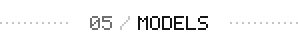</picture>

</div>

| model | size | for |
|---|---|---|
| Base | 57 MB | very fast, average accuracy |
| Small | 181 MB | the best choice without a GPU |
| Medium | 514 MB | more accurate, slow on a CPU |
| **Large v3 Turbo** | 547 MB | accurate and fast on a GPU |
| Large v3 Turbo Q8 | 834 MB | slightly more accurate, more memory |
| Large v3 | 1080 MB | most accurate, slow |

Whisper models come from [huggingface.co/ggerganov/whisper.cpp](https://huggingface.co/ggerganov/whisper.cpp)
and Silero VAD (0.9 MB) from [huggingface.co/ggml-org/whisper-vad](https://huggingface.co/ggml-org/whisper-vad),
both MIT. If Hugging Face is unreachable, switch **Source** to the [hf-mirror.com](https://hf-mirror.com)
mirror. Either way, a download is kept only if its size and **SHA-256** match the published
ones. You can also drop your own `ggml-*.bin` into `~/.local/share/sotto/models/`.

<a id="how-it-works"></a>

<div align="center">

<picture><source media="(prefers-color-scheme: dark)" srcset=".github/assets/label-how-it-works-dark.svg"></picture>

</div>

<div align="center">

<picture><source media="(prefers-color-scheme: dark)" srcset=".github/assets/flow-dark.svg"></picture>

</div>

Recording stays in memory at 16 kHz; Silero VAD cuts silence, then whisper.cpp decodes on the GPU
(Vulkan) or the best CPU variant. The model starts loading while you talk.

<a id="privacy"></a>

<div align="center">

<picture><source media="(prefers-color-scheme: dark)" srcset=".github/assets/label-privacy-dark.svg">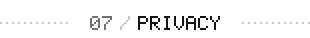</picture>

</div>

Your voice never leaves the computer and is never written to disk. The only network access is
the model download you start yourself. Sotto keeps its settings in `~/.config/sotto/` and models
in `~/.local/share/sotto/models/`; autostart, if you enable it, is
`~/.config/autostart/io.github.trendorin.Sotto.desktop`.

**Removal**: Settings → **Remove Sotto…** or `sotto --uninstall` removes the program (packages
through your package manager), the menu entry, autostart and the hotkey, and optionally models
and settings. From the source folder: `./uninstall.sh` (`--purge` / `--keep`).

<a id="docs"></a>

<div align="center">

<picture><source media="(prefers-color-scheme: dark)" srcset=".github/assets/label-docs-dark.svg"></picture>

</div>

<div align="center">

<a href="https://github.com/Trendorin/sotto/releases/latest"><picture><source media="(prefers-color-scheme: dark)" srcset=".github/assets/link-download-dark.svg"></picture></a> <a href="#models"><picture><source media="(prefers-color-scheme: dark)" srcset=".github/assets/link-models-dark.svg"></picture></a>
<a href="#usage"><picture><source media="(prefers-color-scheme: dark)" srcset=".github/assets/link-commands-dark.svg"></picture></a> <a href="CHANGELOG.md"><picture><source media="(prefers-color-scheme: dark)" srcset=".github/assets/link-changelog-dark.svg"></picture></a>

</div>

### If something does not work

```sh
journalctl --user -t sotto -f     # which microphone, how long, GPU or not, how fast
SOTTO_DEBUG=1 sotto               # whisper / ggml details
```

- **Slow recognition**: the log says `gpu: false` → install a Vulkan driver (on Arch also
  `ggml-vulkan`) or choose **Small**.
- **Text is not pasted**: Settings → **Input access** → **Allow…**. In terminals choose Ctrl+Shift+V.
- **The key does nothing**: check it with **Change…**, or bind any key to `sotto --toggle`.
- **Tip**: put names and terms you often say into **Vocabulary**; whisper will spell them right.

See also [CONTRIBUTING.md](CONTRIBUTING.md) · [SECURITY.md](SECURITY.md) · [CHANGELOG.md](CHANGELOG.md).

<div align="center">

<picture><source media="(prefers-color-scheme: dark)" srcset=".github/assets/eof-dark.svg">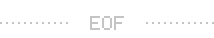</picture>

<br>
<sub>MIT · made by <a href="https://github.com/Trendorin">Trendorin</a></sub>

</div>
