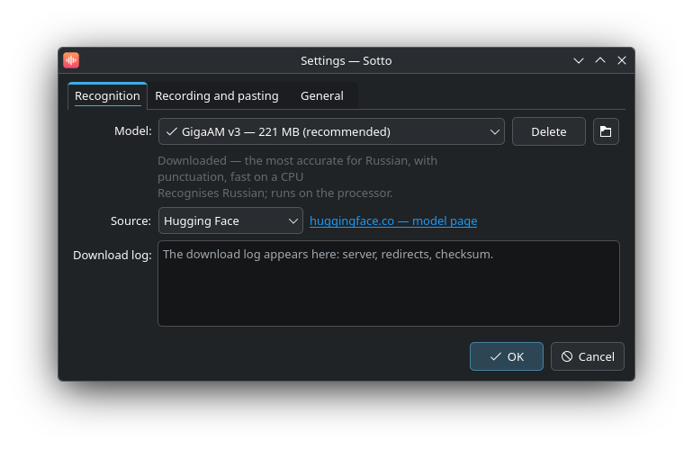

<div align="center">


# Sotto

Voice typing for Linux, local and fast.

[](https://github.com/Trendorin/sotto/releases/latest)
[](LICENSE)


[Download](https://github.com/Trendorin/sotto/releases/latest) · [Install](#install) · [Wiki](docs/wiki/en/README.md) · [Changelog](CHANGELOG.md) · [Русский](README.ru.md)

</div>

<p align="center"></p>

Press a key, speak, and the text appears where the cursor is. Sotto (as in *sotto voce*) lives in
the tray, listens only while you hold or toggle its key, recognises speech on your computer with
whisper.cpp and pastes the result into the active window.

## Features

- Tap the key to start and stop, or hold it while you speak.
- Recognition runs locally. Audio stays in memory and is never written to disk or sent anywhere.
- Fast on a GPU through Vulkan; without one it picks the best build for your processor.
- Made for Wayland: the hotkey comes from the GlobalShortcuts portal and pasting goes through the
  RemoteDesktop portal. No root and no `ydotool`. X11 works too.
- Silero VAD cuts silence first, so whisper does not invent text on a quiet recording.
- Models are downloaded from Hugging Face, a mirror or your own server, with a visible download log,
  and kept only if the size and SHA-256 match.
- C++ and Qt 6 widgets in your system theme. A few megabytes when idle; the model is unloaded
  after a while without use.
- English and Russian interface, picked from the system language.

## Install

| your system | file from the [latest release](https://github.com/Trendorin/sotto/releases/latest) |
|---|---|
| Arch Linux, CachyOS, Manjaro | `sotto-1.2.0-1-x86_64.pkg.tar.zst` |
| Debian 13 and newer | `sotto_1.2.0-1_amd64.deb` |
| Fedora 44 and newer | `sotto-1.2.0-1.fc44.x86_64.rpm` |
| any distribution with glibc 2.35+ | `Sotto-1.2.0-x86_64.AppImage` |

```sh
sudo pacman -U ./sotto-1.2.0-1-x86_64.pkg.tar.zst    # Arch
sudo apt install ./sotto_1.2.0-1_amd64.deb            # Debian
sudo dnf install ./sotto-1.2.0-1.fc44.x86_64.rpm      # Fedora
chmod +x Sotto-1.2.0-x86_64.AppImage && ./Sotto-1.2.0-x86_64.AppImage
```

Every package is built in a clean container of its distribution, then installed and started
there before it is published. Check the files with `sha256sum --ignore-missing -c SHA256SUMS`.
The AppImage carries Qt, whisper.cpp with Vulkan and CPU builds for any processor; on first start
it adds itself to the menu, which the portals need to grant a hotkey.

### From source

You need CMake, a C++ compiler and Qt 6 with Multimedia. If your distribution has whisper.cpp
(Arch: `whisper-cpp`), Sotto uses it; otherwise the installer builds the pinned version for Sotto
alone, with Vulkan when the headers and `glslc` are installed.

```sh
git clone https://github.com/Trendorin/sotto && cd sotto
./install.sh                 # asks a few questions, builds, installs into ~/.local
./install.sh --uninstall     # removes exactly what it installed
```

`./install.sh --help` lists the options (`--yes`, `--prefix`, `--own-whisper`).

## Getting started

1. Start **Sotto** from the menu. The first time, the settings open: download a model
   (**Large v3 Turbo** with a GPU, **Small** without).
2. The default key is **Meta+Space**; change it with **Change…** in the settings.
3. Speak. When you stop, the text is pasted into the active window.

The first paste asks for "remote control" permission: that is the portal Sotto uses to press
Ctrl+V. Tick **Remember**; without it the text stays in the clipboard. Drag the indicator to move
it, click it to stop, right-click to cancel.

```sh
sotto --toggle    # start or stop; bind it to any key in your desktop settings
sotto --start | --stop | --cancel | --settings | --uninstall | --quit
```

## Models

| model | size | for |
|---|---|---|
| Base | 57 MB | very fast, average accuracy |
| Small | 181 MB | the best choice without a GPU |
| Medium | 514 MB | more accurate, slow on a CPU |
| **Large v3 Turbo** | 547 MB | accurate and fast on a GPU |
| Large v3 Turbo Q8 | 834 MB | slightly more accurate, more memory |
| Large v3 | 1080 MB | most accurate, slow |

Whisper models come from [huggingface.co/ggerganov/whisper.cpp](https://huggingface.co/ggerganov/whisper.cpp)
and Silero VAD from [huggingface.co/ggml-org/whisper-vad](https://huggingface.co/ggml-org/whisper-vad),
both MIT. If Hugging Face is unreachable, switch **Source** to the [hf-mirror.com](https://hf-mirror.com)
mirror, or to your own server (**Custom server…**). The settings show a download log with the exact
URL and where the file really comes from. You can also put your own `ggml-*.bin` into
`~/.local/share/sotto/models/`.

## How it works

<picture><source media="(prefers-color-scheme: dark)" srcset=".github/assets/flow-dark.svg"></picture>

Audio is recorded into memory at 16 kHz. Silero VAD cuts the silence, then whisper.cpp decodes on
the GPU (Vulkan) or the best CPU variant. The model starts loading while you are still talking.

## Privacy

Your voice never leaves the computer and is never written to disk. The only network access is
the model download you start yourself. Settings live in `~/.config/sotto/`, models in
`~/.local/share/sotto/models/`.

To remove Sotto, use **Settings → Remove Sotto…** or `sotto --uninstall`: it removes the program,
the menu entry, autostart and the hotkey, and optionally the models and settings.

## Documentation

| | |
|---|---|
| [Installation](docs/wiki/en/install.md) | packages, the source installer, updating, removal |
| [Using Sotto](docs/wiki/en/usage.md) | the key, pasting, the indicator, command line |
| [Models](docs/wiki/en/models.md) | which model to pick, sources, checksums, your own files |
| [Troubleshooting](docs/wiki/en/troubleshooting.md) | logs and common problems |

[Contributing](CONTRIBUTING.md) · [Security policy](SECURITY.md) · [Changelog](CHANGELOG.md)

<div align="center"><sub>MIT · <a href="https://github.com/Trendorin">Trendorin</a></sub></div>
