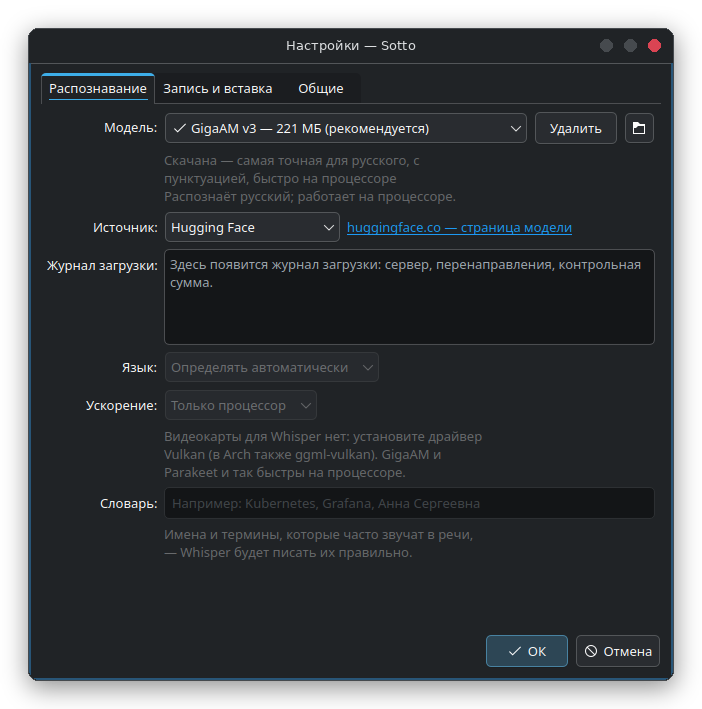

<div align="center">


# Sotto

Голосовой ввод для Linux, локально и быстро.

[](https://github.com/Trendorin/sotto/releases/latest)
[](LICENSE)


[Скачать](https://github.com/Trendorin/sotto/releases/latest) · [Установка](#установка) · [Вики](docs/wiki/ru/README.md) · [Изменения](CHANGELOG.md) · [English](README.md)

</div>

<p align="center"></p>

Нажмите клавишу, скажите — и текст появится там, где стоит курсор. Sotto (от *sotto voce*,
«вполголоса») живёт в трее, слушает только пока вы держите или переключили клавишу, распознаёт
речь на вашем компьютере через whisper.cpp и вставляет результат в активное окно.

## Возможности

- Короткое нажатие — начать и закончить, удержание — запись, пока клавиша зажата.
- Распознавание локальное. Звук остаётся в памяти, не пишется на диск и никуда не отправляется.
- Быстро на видеокарте через Vulkan; без неё выбирается лучшая сборка под ваш процессор.
- Сделан для Wayland: клавиша — через портал GlobalShortcuts, вставка — через RemoteDesktop. Без
  root и без `ydotool`. X11 тоже работает.
- Silero VAD сначала отрезает тишину, чтобы whisper не выдумывал текст на пустой записи.
- Модели скачиваются с Hugging Face, зеркала или вашего сервера, журнал загрузки виден, файл
  сохраняется, только если размер и SHA-256 совпали.
- C++ и виджеты Qt 6 в теме вашей системы. В простое — несколько мегабайт; модель выгружается,
  если ей долго не пользоваться.
- Интерфейс на русском и английском, по языку системы.

## Установка

| ваша система | файл из [последнего релиза](https://github.com/Trendorin/sotto/releases/latest) |
|---|---|
| Arch Linux, CachyOS, Manjaro | `sotto-1.2.4-1-x86_64.pkg.tar.zst` |
| Debian 13 и новее | `sotto_1.2.4-1_amd64.deb` |
| Fedora 44 и новее | `sotto-1.2.4-1.fc44.x86_64.rpm` |
| любой дистрибутив с glibc 2.35+ | `Sotto-1.2.4-x86_64.AppImage` |

```sh
sudo pacman -U ./sotto-1.2.4-1-x86_64.pkg.tar.zst    # Arch
sudo apt install ./sotto_1.2.4-1_amd64.deb            # Debian
sudo dnf install ./sotto-1.2.4-1.fc44.x86_64.rpm      # Fedora
chmod +x Sotto-1.2.4-x86_64.AppImage && ./Sotto-1.2.4-x86_64.AppImage
```

Каждый пакет собирается в чистом контейнере своего дистрибутива, затем ставится и запускается
там до публикации. Проверить файлы: `sha256sum --ignore-missing -c SHA256SUMS`.
В AppImage есть Qt, whisper.cpp с Vulkan и сборки под любой процессор; при первом запуске он
добавляет себя в меню — без этого порталы не выдают горячую клавишу.

### Из исходников

`install.sh` проверит CMake, компилятор C++ и Qt 6.5+ с Multimedia и предложит поставить
недостающее через pacman, apt, dnf или zypper. Если в дистрибутиве есть whisper.cpp
(в Arch — `whisper-cpp`), Sotto использует его; иначе установщик соберёт закреплённую версию
только для Sotto, с Vulkan.

```sh
git clone https://github.com/Trendorin/sotto && cd sotto
./install.sh                 # задаст пару вопросов, соберёт и поставит в ~/.local
./install.sh --uninstall     # удалит ровно то, что поставил
```

`./install.sh --help` покажет параметры (`--yes`, `--prefix`, `--own-whisper`,
`--no-packages`).

## Начало работы

1. Запустите **Sotto** из меню. В первый раз откроются настройки: скачайте модель
   (**Large v3 Turbo** с видеокартой, **Small** без неё).
2. Клавиша по умолчанию — **Meta+Space**, поменять её можно кнопкой **Изменить…** в настройках.
3. Говорите. Когда закончите, текст вставится в активное окно.

При первой вставке система спросит разрешение на «удалённое управление» — через этот портал Sotto
нажимает Ctrl+V. Отметьте **Запомнить**; без разрешения текст останется в буфере обмена.
Индикатор можно перетащить, клик — остановить, правый клик — отменить.

```sh
sotto --toggle    # начать или закончить; можно повесить на любую клавишу в настройках среды
sotto --start | --stop | --cancel | --settings | --uninstall | --quit
```

## Модели

| модель | размер | для чего |
|---|---|---|
| Base | 57 МБ | очень быстро, средняя точность |
| Small | 181 МБ | лучший выбор без видеокарты |
| Medium | 514 МБ | точнее, но на процессоре медленно |
| **Large v3 Turbo** | 547 МБ | точно и быстро на видеокарте |
| Large v3 Turbo Q8 | 834 МБ | чуть точнее, больше памяти |
| Large v3 | 1080 МБ | максимум точности, медленно |

Модели Whisper берутся с [huggingface.co/ggerganov/whisper.cpp](https://huggingface.co/ggerganov/whisper.cpp),
Silero VAD — с [huggingface.co/ggml-org/whisper-vad](https://huggingface.co/ggml-org/whisper-vad),
обе под MIT. Если Hugging Face недоступен, переключите **Источник** на зеркало
[hf-mirror.com](https://hf-mirror.com) или на свой сервер (**Свой сервер…**). В настройках виден журнал
загрузки с точным URL и тем, откуда файл приходит на самом деле. Свою `ggml-*.bin` можно положить в
`~/.local/share/sotto/models/`.

## Как устроено

<picture><source media="(prefers-color-scheme: dark)" srcset=".github/assets/flow-ru-dark.svg"></picture>

Звук пишется в память с частотой 16 кГц. Silero VAD отрезает тишину, затем whisper.cpp
распознаёт на видеокарте (Vulkan) или на лучшем варианте для процессора. Модель начинает
грузиться, пока вы ещё говорите.

## Приватность

Голос не покидает компьютер и не пишется на диск. Единственный выход в сеть — загрузка модели,
которую запускаете вы. Настройки — в `~/.config/sotto/`, модели — в `~/.local/share/sotto/models/`.

Удалить Sotto: **Настройки → Удалить Sotto…** или `sotto --uninstall`. Удаляются программа,
ярлык, автозапуск и клавиша, по желанию — модели и настройки.

## Документация

| | |
|---|---|
| [Установка](docs/wiki/ru/install.md) | пакеты, установщик из исходников, обновление, удаление |
| [Работа с Sotto](docs/wiki/ru/usage.md) | клавиша, вставка, индикатор, командная строка |
| [Модели](docs/wiki/ru/models.md) | какую выбрать, источники, контрольные суммы, свои файлы |
| [Если не работает](docs/wiki/ru/troubleshooting.md) | журнал и частые проблемы |

[Участие](CONTRIBUTING.md) · [Безопасность](SECURITY.md) · [Изменения](CHANGELOG.md)

<div align="center"><sub>MIT · <a href="https://github.com/Trendorin">Trendorin</a></sub></div>
