<div align="center">

[](README.md)
[](README.ru.md)

<picture><source media="(prefers-color-scheme: dark)" srcset=".github/assets/header-ru-dark.svg"></picture>

**Голосовой ввод для Linux.**<br>
Нажали клавишу, сказали, отпустили — и текст появился там, где стоит курсор. Локальный whisper.cpp, Vulkan, Wayland.

[](https://github.com/Trendorin/sotto/releases/latest) [](LICENSE)  <br>
[](#install) [](#usage)

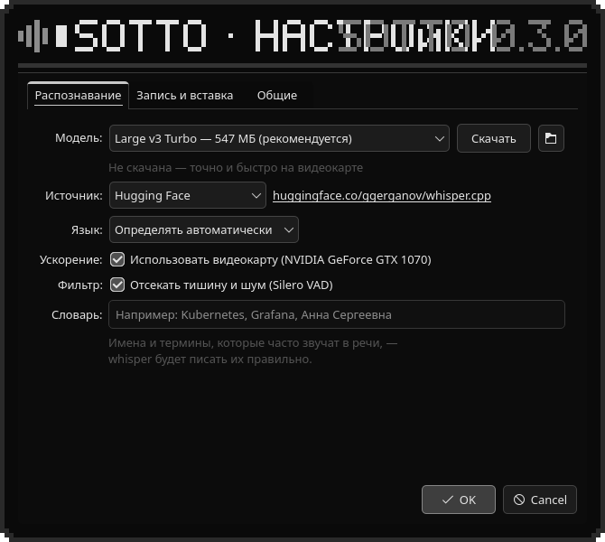

[](https://github.com/Trendorin/sotto/releases/latest)
[](#install)
[](#docs)

</div>

<a id="about"></a>

<div align="center">

<picture><source media="(prefers-color-scheme: dark)" srcset=".github/assets/label-about-ru-dark.svg">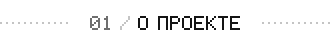</picture>

</div>

Sotto (от *sotto voce*, «вполголоса») — маленькое нативное приложение, которое превращает речь в
текст прямо там, где вы печатаете. Живёт в трее, слушает только пока вы держите или переключили
клавишу, распознаёт речь локально через whisper.cpp и вставляет результат в активное окно.

- **Нативный и лёгкий**: C++, Qt 6 и whisper.cpp, без Python и Electron. В простое — несколько
  мегабайт; модель выгружается, если ей долго не пользоваться.
- **Выглядит как система**: обычные виджеты Qt с вашей темой, акцентом и шрифтами.
- **Сделан для Wayland**: индикатор висит поверх окон через `wlr-layer-shell` и не забирает фокус;
  клавиша — через портал GlobalShortcuts, вставка — через RemoteDesktop. Без root и `ydotool`.
- **Интерфейс на русском и английском** — по языку системы.

<div align="center">

<picture><source media="(prefers-color-scheme: dark)" srcset=".github/assets/mark-dark.svg"></picture> <picture><source media="(prefers-color-scheme: dark)" srcset=".github/assets/spec-ru-dark.svg"></picture>

</div>

<a id="features"></a>

<div align="center">

<picture><source media="(prefers-color-scheme: dark)" srcset=".github/assets/label-features-ru-dark.svg"></picture>

</div>

<div align="center">

<picture><source media="(prefers-color-scheme: dark)" srcset=".github/assets/feature-hotkey-ru-dark.svg"></picture> <picture><source media="(prefers-color-scheme: dark)" srcset=".github/assets/feature-local-ru-dark.svg"></picture>
<picture><source media="(prefers-color-scheme: dark)" srcset=".github/assets/feature-fast-ru-dark.svg"></picture> <picture><source media="(prefers-color-scheme: dark)" srcset=".github/assets/feature-clean-ru-dark.svg"></picture>
<picture><source media="(prefers-color-scheme: dark)" srcset=".github/assets/feature-wayland-ru-dark.svg"></picture> <picture><source media="(prefers-color-scheme: dark)" srcset=".github/assets/feature-verified-ru-dark.svg"></picture>

</div>

<a id="install"></a>

<div align="center">

<picture><source media="(prefers-color-scheme: dark)" srcset=".github/assets/label-install-ru-dark.svg"></picture>

</div>

| ваша система | файл из [последнего релиза](https://github.com/Trendorin/sotto/releases/latest) |
|---|---|
| **Arch Linux**, CachyOS, Manjaro | `sotto-0.3.0-1-x86_64.pkg.tar.zst` |
| **Debian 13** и новее | `sotto_0.3.0-1_amd64.deb` |
| **Fedora 44** и новее | `sotto-0.3.0-1.fc44.x86_64.rpm` |
| **любой дистрибутив** с glibc 2.35+ | `Sotto-0.3.0-x86_64.AppImage`, без установки |

```sh
sudo pacman -U ./sotto-0.3.0-1-x86_64.pkg.tar.zst       # Arch
sudo apt install ./sotto_0.3.0-1_amd64.deb               # Debian
sudo dnf install ./sotto-0.3.0-1.fc44.x86_64.rpm       # Fedora
chmod +x Sotto-0.3.0-x86_64.AppImage && ./Sotto-0.3.0-x86_64.AppImage
```

Каждый пакет собирается в чистом контейнере своего дистрибутива, ставится и запускается там
до публикации. Проверить загрузку: `sha256sum --ignore-missing -c SHA256SUMS`.

В AppImage всё нужное: Qt, whisper.cpp, Vulkan-ускорение и сборки под любой процессор; для
видеокарты нужен системный загрузчик Vulkan. При первом запуске он добавляет себя в меню (без
этого порталы не выдают горячую клавишу).

<details>
<summary><b>Сборка из исходников</b></summary>

В Arch `./install.sh` собирает настоящий пакет pacman. В других системах ставит в `~/.local`, нужны
cmake, компилятор C++, Qt 6 (Widgets, Multimedia, DBus, Network, Wayland), layer-shell-qt,
whisper.cpp и wl-clipboard.

```sh
git clone https://github.com/Trendorin/sotto && cd sotto
./install.sh
packaging/appimage/build.sh     # свой AppImage без root, docker и podman
```

</details>

<a id="usage"></a>

<div align="center">

<picture><source media="(prefers-color-scheme: dark)" srcset=".github/assets/label-usage-ru-dark.svg">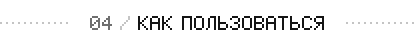</picture>

</div>

1. Запустите **Sotto** из меню. В первый раз откроются настройки: скачайте модель
   (**Large v3 Turbo** с видеокартой, **Small** без неё).
2. Клавиша по умолчанию — **Meta+Space**, поменять — кнопкой **Изменить…**.
   **Короткое нажатие** — запись до следующего нажатия, **удержание** — пока клавиша зажата.
3. Когда вы закончите, текст вставится в активное окно.

При первой вставке система спросит разрешение на «удалённое управление» — через этот портал Sotto
нажимает Ctrl+V. Отметьте **Запомнить**; без разрешения текст останется в буфере обмена.
Индикатор можно перетащить; клик — остановить, правый клик — отменить.

```sh
sotto --toggle    # начать / закончить (можно повесить на любую клавишу в настройках среды)
sotto --start | --stop | --cancel | --settings | --uninstall | --quit
```

<a id="models"></a>

<div align="center">

<picture><source media="(prefers-color-scheme: dark)" srcset=".github/assets/label-models-ru-dark.svg">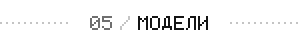</picture>

</div>

| модель | размер | для чего |
|---|---|---|
| Base | 57 МБ | очень быстро, средняя точность |
| Small | 181 МБ | лучший выбор без видеокарты |
| Medium | 514 МБ | точнее, но на процессоре медленно |
| **Large v3 Turbo** | 547 МБ | точно и быстро на видеокарте |
| Large v3 Turbo Q8 | 834 МБ | чуть точнее, больше памяти |
| Large v3 | 1080 МБ | максимум точности, медленно |

Модели Whisper берутся с [huggingface.co/ggerganov/whisper.cpp](https://huggingface.co/ggerganov/whisper.cpp),
Silero VAD (0,9 МБ) — с [huggingface.co/ggml-org/whisper-vad](https://huggingface.co/ggml-org/whisper-vad),
обе под MIT. Если Hugging Face недоступен, переключите **Источник** на зеркало
[hf-mirror.com](https://hf-mirror.com). В любом случае файл сохраняется, только если его размер и
**SHA-256** совпали с опубликованными. Свою `ggml-*.bin` можно положить в `~/.local/share/sotto/models/`.

<a id="how-it-works"></a>

<div align="center">

<picture><source media="(prefers-color-scheme: dark)" srcset=".github/assets/label-how-it-works-ru-dark.svg">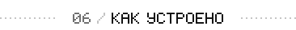</picture>

</div>

<div align="center">

<picture><source media="(prefers-color-scheme: dark)" srcset=".github/assets/flow-ru-dark.svg"></picture>

</div>

Запись идёт в память с частотой 16 кГц; Silero VAD отрезает тишину, затем whisper.cpp распознаёт
на видеокарте (Vulkan) или на лучшем варианте для процессора. Модель начинает грузиться, пока вы говорите.

<a id="privacy"></a>

<div align="center">

<picture><source media="(prefers-color-scheme: dark)" srcset=".github/assets/label-privacy-ru-dark.svg">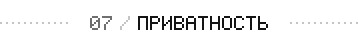</picture>

</div>

Голос не покидает компьютер и не пишется на диск. Единственный выход в сеть — загрузка модели,
которую запускаете вы. Настройки — в `~/.config/sotto/`, модели — в `~/.local/share/sotto/models/`,
автозапуск (если включён) — `~/.config/autostart/io.github.trendorin.Sotto.desktop`.

**Удаление**: Настройки → **Удалить Sotto…** или `sotto --uninstall` удаляют программу (пакеты —
через менеджер пакетов), ярлык, автозапуск и клавишу, по желанию — модели и настройки.
Из папки с исходниками: `./uninstall.sh` (`--purge` / `--keep`).

<a id="docs"></a>

<div align="center">

<picture><source media="(prefers-color-scheme: dark)" srcset=".github/assets/label-docs-ru-dark.svg">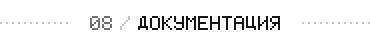</picture>

</div>

<div align="center">

<a href="https://github.com/Trendorin/sotto/releases/latest"><picture><source media="(prefers-color-scheme: dark)" srcset=".github/assets/link-download-ru-dark.svg"></picture></a> <a href="#models"><picture><source media="(prefers-color-scheme: dark)" srcset=".github/assets/link-models-ru-dark.svg"></picture></a>
<a href="#usage"><picture><source media="(prefers-color-scheme: dark)" srcset=".github/assets/link-commands-ru-dark.svg"></picture></a> <a href="CHANGELOG.md"><picture><source media="(prefers-color-scheme: dark)" srcset=".github/assets/link-changelog-ru-dark.svg"></picture></a>

</div>

### Если что-то не работает

```sh
journalctl --user -t sotto -f     # какой микрофон, сколько записано, видеокарта или нет, скорость
SOTTO_DEBUG=1 sotto               # подробности whisper / ggml
```

- **Долго распознаёт**: в логе `gpu: false` → поставьте драйвер Vulkan (в Arch ещё `ggml-vulkan`)
  или выберите **Small**.
- **Текст не вставляется**: Настройки → **Доступ к вводу** → **Разрешить…**. В терминалах — Ctrl+Shift+V.
- **Клавиша не срабатывает**: проверьте её через **Изменить…** или повесьте любую клавишу на `sotto --toggle`.
- **Совет**: впишите в **Словарь** имена и термины, которые часто произносите, — whisper будет писать их правильно.

Также: [CONTRIBUTING.md](CONTRIBUTING.md) · [SECURITY.md](SECURITY.md) · [CHANGELOG.md](CHANGELOG.md).

<div align="center">

<picture><source media="(prefers-color-scheme: dark)" srcset=".github/assets/eof-dark.svg"></picture>

<br>
<sub>MIT · автор <a href="https://github.com/Trendorin">Trendorin</a></sub>

</div>
