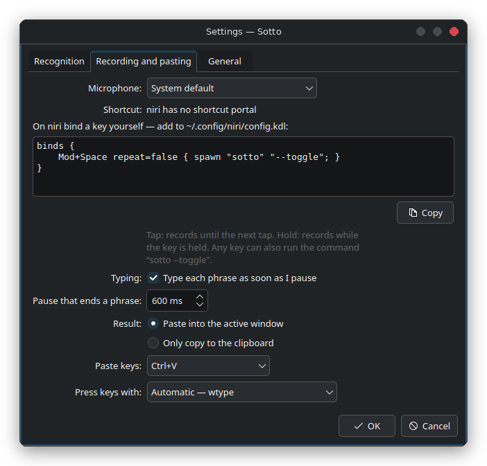

# Desktops and tiling compositors

| | key | pasting | indicator | tray |
|---|---|---|---|---|
| KDE Plasma | GlobalShortcuts portal | RemoteDesktop portal | layer-shell | yes |
| GNOME 48+ | GlobalShortcuts portal | RemoteDesktop portal | XWayland window | with an extension |
| COSMIC | custom shortcut (below) or the portal | RemoteDesktop portal (COSMIC 1.7+) | layer-shell | yes |
| Hyprland | `hyprland.conf` (below) | wtype | layer-shell | with a bar |
| niri | `config.kdl` (below) | wtype | layer-shell | with a bar |
| sway, river, Wayfire, labwc | config (below) | wtype | layer-shell | with a bar |

<p align="center"></p>

The settings show the right lines for the desktop you are on, with the path to Sotto filled in, and
**Copy** puts them in the clipboard. `sotto --keybind` prints the same in a terminal. Without a tray,
messages ("model downloaded", errors) go to your notification daemon (mako, dunst, swaync, ...),
and the settings open with `sotto --settings` or from the app menu.

Pasting on these compositors needs `wtype` (`pacman -S wtype`, `apt install wtype`,
`dnf install wtype`); the source installer offers it there. `ydotool` works too.

## niri

`~/.config/niri/config.kdl`:

```kdl
binds {
    Mod+Space repeat=false { spawn "sotto" "--toggle"; }
}
```

The key toggles: tap to start, tap to stop.

## Hyprland

`~/.config/hypr/hyprland.conf`:

```ini
bind = SUPER, SPACE, exec, sotto --toggle
# or hold to talk:
# bind = SUPER, SPACE, exec, sotto --start
# bindr = SUPER, SPACE, exec, sotto --stop
```

## sway

`~/.config/sway/config`:

```
bindsym $mod+space exec sotto --toggle
# or hold to talk:
# bindsym $mod+space exec sotto --start
# bindsym --release $mod+space exec sotto --stop
```

## river

```sh
riverctl map normal Super Space spawn 'sotto --toggle'
```

## Wayfire

`~/.config/wayfire.ini`:

```ini
[command]
binding_sotto = <super> KEY_SPACE
command_sotto = sotto --toggle
```

## labwc

`~/.config/labwc/rc.xml`, inside `<keyboard>`:

```xml
<keybind key="W-space">
  <action name="Execute" command="sotto --toggle"/>
</keybind>
```

## COSMIC

**Settings → Keyboard → Keyboard Shortcuts → Custom Shortcuts → Add Shortcut**, command
`sotto --toggle`. If `wl-copy` cannot set the clipboard, start the session with
`COSMIC_DATA_CONTROL_ENABLED=1` (COSMIC keeps the data-control protocol behind that switch).

## AppImage

Use the path of the AppImage instead of `sotto`, for example
`spawn "/home/you/Apps/Sotto-2.0.0-x86_64.AppImage" "--toggle"`. The settings and `--keybind`
already put it in.
