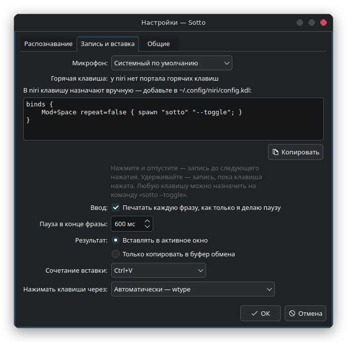

# Рабочие столы и тайлинговые композиторы

| | клавиша | вставка | индикатор | трей |
|---|---|---|---|---|
| KDE Plasma | портал GlobalShortcuts | портал RemoteDesktop | layer-shell | есть |
| GNOME 48+ | портал GlobalShortcuts | портал RemoteDesktop | окно XWayland | с расширением |
| COSMIC | своё сочетание (ниже) или портал | портал RemoteDesktop (COSMIC 1.7+) | layer-shell | есть |
| Hyprland | `hyprland.conf` (ниже) | wtype | layer-shell | с панелью |
| niri | `config.kdl` (ниже) | wtype | layer-shell | с панелью |
| sway, river, Wayfire, labwc | конфиг (ниже) | wtype | layer-shell | с панелью |

<p align="center"></p>

Настройки показывают нужные строки для того рабочего стола, на котором вы сейчас, с уже
подставленным путём к Sotto, а кнопка **Копировать** кладёт их в буфер обмена. `sotto --keybind`
выводит то же в терминал. Без трея сообщения («модель скачана», ошибки) уходят в ваш демон
уведомлений (mako, dunst, swaync, …), а настройки открываются командой `sotto --settings` или из
меню приложений.

Для вставки в этих композиторах нужен `wtype` (`pacman -S wtype`, `apt install wtype`,
`dnf install wtype`); установщик из исходников предлагает его там сам. Подойдёт и `ydotool`.

## niri

`~/.config/niri/config.kdl`:

```kdl
binds {
    Mod+Space repeat=false { spawn "sotto" "--toggle"; }
}
```

Клавиша переключает запись: нажали — пошла запись, нажали ещё раз — остановилась.

## Hyprland

`~/.config/hypr/hyprland.conf`:

```ini
bind = SUPER, SPACE, exec, sotto --toggle
# или говорить, удерживая клавишу:
# bind = SUPER, SPACE, exec, sotto --start
# bindr = SUPER, SPACE, exec, sotto --stop
```

## sway

`~/.config/sway/config`:

```
bindsym $mod+space exec sotto --toggle
# или говорить, удерживая клавишу:
# bindsym $mod+space exec sotto --start
# bindsym --release $mod+space exec sotto --stop
```

## river

```sh
riverctl map normal Super Space spawn 'sotto --toggle'
```

## Wayfire

`~/.config/wayfire.ini`:

```ini
[command]
binding_sotto = <super> KEY_SPACE
command_sotto = sotto --toggle
```

## labwc

`~/.config/labwc/rc.xml`, внутри `<keyboard>`:

```xml
<keybind key="W-space">
  <action name="Execute" command="sotto --toggle"/>
</keybind>
```

## COSMIC

**Настройки → Клавиатура → Сочетания клавиш → Свои сочетания → Добавить**, команда
`sotto --toggle`. Если `wl-copy` не может положить текст в буфер обмена, запускайте сеанс с
`COSMIC_DATA_CONTROL_ENABLED=1` (COSMIC держит протокол data-control за этим переключателем).

## AppImage

Вместо `sotto` укажите путь к AppImage, например
`spawn "/home/you/Apps/Sotto-2.0.1-x86_64.AppImage" "--toggle"`. Настройки и `--keybind` уже
подставляют его сами.
